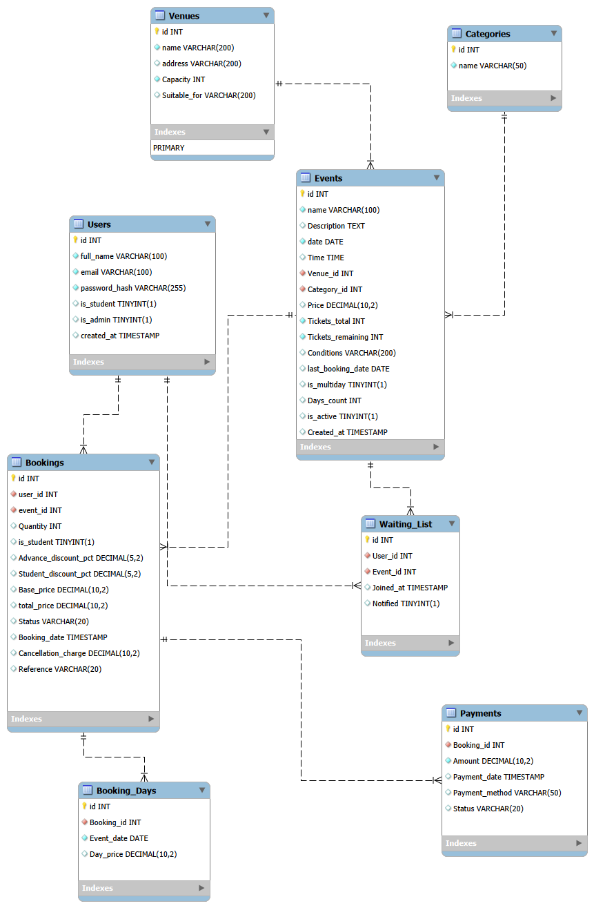

# Bristol Community Events

Bristol Community Events is a Flask and MySQL web application for discovering local events and managing ticket bookings. It was developed as a university project at the University of the West of England (UWE Bristol).

## Features

### Event discovery and booking
- Browse events and filter by category, date, and free entry.
- View event details and book tickets.
- Apply advance-booking discounts and a UWE student discount.
- Complete a simulated payment form with basic card-field validation.
- View booking history, download receipts, cancel bookings, and join a waiting list for sold-out events.

### Administration
- Manage events, venues, users, and bookings.
- View sales, booking, venue, and customer reports.
- Apply a 25% price reduction to an event.

### Implementation
- Responsive HTML, CSS, and JavaScript interface.
- Password hashing with Werkzeug.
- Parameterised SQL queries and role checks for admin pages.
- Flask sessions configured with an environment-based secret key.

## Technology
- Python 3.10+
- Flask 3.1
- MySQL 8.0+
- MySQL Connector/Python
- HTML, CSS, and JavaScript

## Project structure

```text
event-booking-website/
├── README.md
├── .gitignore
├── Database/
│   ├── bce_dump.sql
│   └── ERD.png
└── website/
    ├── app.py
    ├── requirements.txt
    ├── static/
    │   └── style.css
    └── templates/
        ├── admin/
        │   ├── bookings.html
        │   ├── dashboard.html
        │   ├── events.html
        │   ├── reports.html
        │   ├── users.html
        │   └── venues.html
        └── customer and shared page templates
```

## Run locally

### Requirements
- Python 3.10 or later
- MySQL Server 8.0 or later

### 1. Set up the database

Open `Database/bce_dump.sql` in MySQL Workbench, connect to your local MySQL server, and run the complete script. It creates the `bce` database and its tables, then adds three example categories, two venues, and three future-dated events.

The script includes no user accounts, bookings, or payment records. Import it once into a fresh database; its sample rows use fixed IDs and are not intended to be inserted repeatedly.

### 2. Install the Python dependencies

From the repository folder, open PowerShell and run:

```powershell
cd website
python -m venv .venv
.\.venv\Scripts\Activate.ps1
python -m pip install -r requirements.txt
```

If PowerShell blocks virtual-environment activation, use Command Prompt and run `.venv\Scripts\activate.bat`, then install the requirements as above.

### 3. Configure and start the application

In the same PowerShell window, set the connection details for your local MySQL account. Replace the example password with your own local MySQL password:

```powershell
$env:DB_HOST = "localhost"
$env:DB_USER = "root"
$env:DB_PASSWORD = "your-local-MySQL-password"
$env:DB_NAME = "bce"
$env:FLASK_SECRET_KEY = (python -c "import secrets; print(secrets.token_hex(32))")
python app.py
```

These settings apply only to that PowerShell window. The app reads them from environment variables; do not put real passwords or secret keys in the repository. Open [http://127.0.0.1:5000](http://127.0.0.1:5000) in your browser.

### Local admin account

There are no admin credentials in the repository or sample database. To create a local admin account:

1. Register a normal account through the website.
2. In MySQL Workbench, run this query, replacing the example email with the email you registered:

   ```sql
   USE bce;
   UPDATE users SET is_admin = 1 WHERE email = 'your-email@example.com';
   ```

3. Log out and back in to load the admin role.

Do not publish your personal account details or password.

## Limitations and testing status
- Payment is simulated; no payment provider is connected and no real payment is taken.
- Card fields receive basic format checks only.
- Waiting-list entries are recorded, but no email notifications are sent.
- Multi-day event fields exist in the database, but multi-day bookings are not available through the interface.
- The forms do not currently include CSRF protection; the project is a coursework demonstration, not a live booking service.
- No automated test suite is included.

## Future improvements
- Add automated tests for booking, cancellation, and admin workflows.
- Add CSRF protection and strengthen server-side form validation.
- Integrate a payment provider and email notifications.
- Implement multi-day booking through the interface.

## Database diagram



## Author

**Mostafa Abdelkarim** · BSc (Hons) Computer Science, UWE Bristol · [LinkedIn](https://www.linkedin.com/in/mostafa-ayman-8045a7399/)
